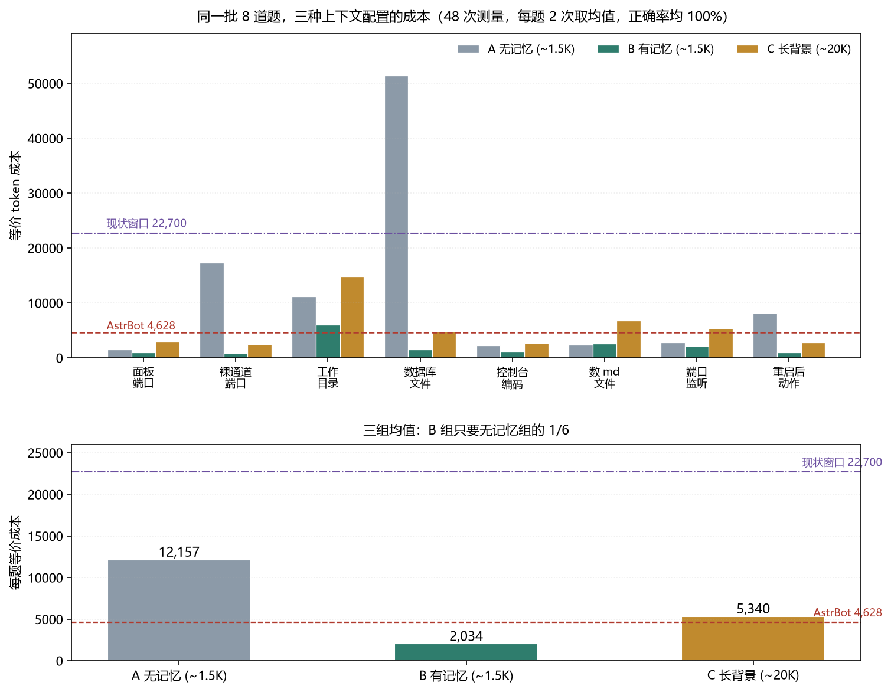
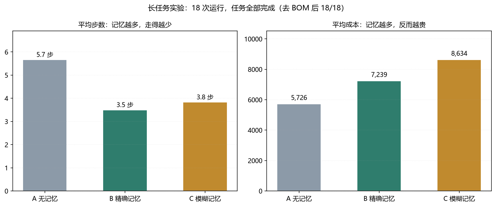
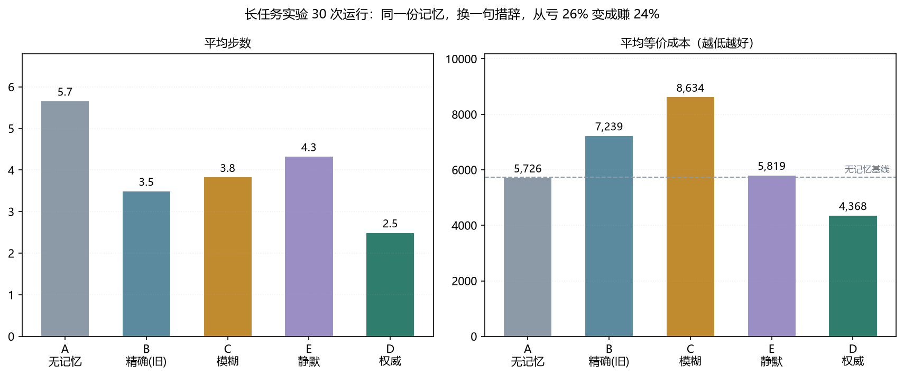

# dsh-context-budget

一个 DeepSeek Harness（DSH）插件：**盯着当前会话的上下文，超预算就带着一份交接摘要轮转到新会话**。
附一组可复现的测量——省 token 的杠杆不是缓存命中率，是「记忆刚刚够用」，以及「怎么把记忆告诉模型」。

> 摘要：8 道题、3 组配置、48 次运行。带 1.5K 记忆的会话每题 **2,034** 等价成本，无记忆 **12,158**，20K 长背景 **5,340**——三组全对。
> 但长任务里同样的记忆一度**贵 26%**；只把措辞换成「【权威记录·无需核实】」，就变成**便宜 24%**。
> 全部是**等价 token**，不是账单；单机、单模型，样本量见各表。

---

## 先看这个：什么时候省，什么时候不省

**这套东西不是"装上就省 6 倍"。** 插件本身只做记账和轮转，省不省取决于你怎么用。

| 会省 | 不会省 |
|---|---|
| 答案在记忆里、现查很贵：翻磁盘、搜文件、翻历史 | 每步工具输出很大：新内容永远全价，缓存帮不上 |
| 会话很长，上下文越滚越大 | 频繁开新会话：前缀重建的固定成本摊不开 |
| 任务边界清晰，能写出具体的交接摘要 | 摘要只能写"之前聊了很多"：下一段会把活重做一遍 |
| 工具集固定、系统提示稳定（前缀不变） | 每步都在改系统提示 / 工具集：前缀失效，缓存全丢 |

三句实话：

1. **插件不自动改变模型行为。** 不轮转 = 收益 0。它给的是"什么时候该切"的仪表盘和一个切的动作，不是自动挡。
2. **"省 6 倍"只在事实类问题上成立**（实验一：8 道题里 6 道答案在记忆里）。工具密集型任务上我们**没有证据**能省，实验二反而是亏 26%。
3. **所有成本都是等价 token**（按缓存价 1/10 折算），不是账单金额。别拿它跟别人的账单数字比。

---

## 结论

1. **省钱的不是缓存，是步数。** 长会话里命中率已经 99.8%（本机 40 步实测），没有空间；真正的乘数是「一次任务走几步」——每步都要把上下文重读一遍。
2. **记忆要在「查一下很贵」的时候才值钱。** 答案藏在磁盘深处（实验一第 4 题，n=2），省 6 倍；答案就在眼前两个小文件（实验二，n=6），记忆反而亏 26%。
3. **同一份记忆，措辞决定它是资产还是负债。** 自然语言陈述「你已经完成了……」→ 模型不信，自己去核实 → 上下文被撑大；换成「【权威记录·无需核实】直接使用」→ 省 24%。

详见 [docs/FINDINGS.md](docs/FINDINGS.md)（全部数据、反例、方差）和 [docs/DESIGN.md](docs/DESIGN.md)（插件设计）。

---

## 这个插件做什么

| 做 | 不做 |
|---|---|
| 每步记账：步数、上下文、未命中/命中/输出 token、等价成本 | 不替你压缩历史（压缩是模型的事） |
| 超预算时提醒，并提供 `context_budget` 工具手动轮转 | 不自动搬记忆（需要你写摘要） |
| 轮转时开新会话、带上交接摘要、写 `active_session.json` 供外部桥接跟随 | 不改系统提示，不碰模型调用 |

`context_budget` 两个动作：

```text
status  → 预算 / 会话数 / 步数 / 当前上下文 / 等价成本 / 是否超预算
rotate  → 建新会话（指定 cwd）→ 投递交接摘要 → 写 active_session.json / handoffs.jsonl → 返回新 sessionId
```

轮转时注入的摘要长这样（这层措辞是实测结论，不是随手写的）：

```text
【权威记录·无需核实】以下是你自己在上一段对话结束时写下的交接摘要。
它是你自己的记忆，直接使用，不要调用工具去核实，也不要重新做一遍已经做完的事。
```

---

## 安装

插件是纯 ESM，不依赖 npm 包，只调用宿主已有服务（`tools` / `session/event` / `sessionController` / `workspaceRegistry`）。

**1. 放到 DSH 的本地插件目录**

```bash
git clone <this-repo> ~/.dsh/local-plugins/dsh-context-budget
# Windows: C:\Users\<you>\.dsh\local-plugins\dsh-context-budget
```

**2. 在 profile 里注册**（`<DSH_HOME>/profiles/<profile>/package.json`）

```jsonc
{
  "dependencies": {
    "dsh-context-budget": "file:../../local-plugins/dsh-context-budget"
  },
  "dsh": {
    "profile": {
      "bundles": ["@deepseek-ai/dsh-base", "@deepseek-ai/dsh-web-app", "dsh-context-budget"]
    }
  }
}
```

**3. 加配置层**（`<DSH_HOME>/profiles/<profile>/cordis.patch.yml`）

```yaml
- insert:
    - id: dsh-context-budget
      name: dsh-context-budget
      config:
        budgetTokens: 20000
        cachePriceRatio: 0.1
        cwd: C:/Users/you/your-workspace   # 必填，见下
```

> 必须用 `insert:` 形式。直接写 `- id: dsh-context-budget` 会被 loader 当成「对未知目标的补丁」静默跳过，插件不会加载。

**4. 重启 DSH**，看 `<dataDir>/budget.log` 出现 `已加载，预算 20000 token` 就算装好。

---

## 配置

| 键 | 默认 | 说明 |
|---|---|---|
| `budgetTokens` | `20000` | 单步 `input + cacheRead` 超过它就判超预算并记日志 |
| `cachePriceRatio` | `0.1` | 缓存命中价 / 未命中价，只用于算等价成本；换价格就改这里 |
| `cwd` | 空 | 轮转出来的新会话开在哪个目录。**留空会拒绝轮转** |
| `dataDir` | `<DSH_HOME>/context-budget` | `state.json` / `active_session.json` / `budget.log` / `handoffs.jsonl` |
| `agentPreset` | 空 | 新会话用哪个 preset，留空用宿主默认 |

### 为什么 `cwd` 必须显式配

踩过一次：轮转出来的会话落在 profile 目录，不在工作区，工具全在错的目录里跑。
宿主不会把「当前会话的 cwd」告诉我，插件也不该猜——猜错比报错更难查。所以干脆拒绝：

```json
{"action":"rotate","ok":false,"note":"配置里没设 cwd，拒绝轮转：宿主默认目录经常和工作区不一样，会把新会话开错地方"}
```

---

## 实测

**口径**：DSH desktop、deepseek-flash（reasoningEffort=max）、单机、单账号。
等价成本 = `miss + cache × 0.1 + out`，缓存按 1/10 折算成"未命中 token"——**是等价 token，不是账单金额**（没和真实账单核对过）。
每组样本量标在小标题里。

全部数据在 [`bench/data/`](bench/data)，图在 [`bench/img/`](bench/img)。

### ① 8 道题 × 3 组配置 × 2 次 = 48 次（每组 16 次）



| 组 | 记忆 | 每步上下文 | 每题等价成本 | 步数 | 正确率 |
|---|---|---:|---:|---:|---:|
| A 无记忆 | — | 9,818 | **12,158** | 3.44 | 16/16 |
| **B 有记忆** | 1.5K | 7,868 | **2,034** | 1.75 | 16/16 |
| C 长背景 | 20K | 27,565 | 5,340 | 1.75 | 16/16 |

B 组只要无记忆的 **1/6**；C 组记忆多 13 倍，贵 2.6 倍，正确率一样。

### ② 长任务：记忆反而亏 26%（每组 6 次，共 18 次）



任务：目录里已有 `step1.txt=1`、`step2.txt=2`，新建 `step3.txt = 3`。判分直接读磁盘。

| 组 | 步数 | 每步上下文 | 等价成本 | 完成 |
|---|---:|---:|---:|---:|
| A 无记忆 | 5.67 | 6,845 | **5,726** | 6/6 |
| B 精确记忆（旧措辞） | 3.50 | 17,906 | 7,240 | 6/6 |
| C 模糊记忆 | 3.83 | 20,379 | 8,634 | 4/6 |

步数省 38%，上下文贵 162%，**净成本反而 +26%**。

原因不在记忆本身（它只有 50 个 token），在「注入记忆」这个动作：模型收到「你已经完成了前两步」之后，会先去目录里确认一遍。**它不相信记忆，非要自己看一眼**，那一轮探索的输出从此留在前缀里，每步重读。

### ③ 只改一句措辞：+26% → −24%（每组 6 次，共 12 次）



| 组 | 注入内容 | 步数 | 等价成本 | 相对无记忆 |
|---|---|---:|---:|---:|
| A 无记忆 | — | 5.67 | 5,726 | — |
| B 精确（旧） | 「你已经完成了前两步……」 | 3.50 | 7,240 | **+26%** |
| E 静默 | 只给事实：`step1.txt = 1；step2.txt = 2` | 4.33 | 5,819 | +2% |
| **D 权威** | 「【权威记录·无需核实】……不要再调用工具去确认」 | **2.50** | **4,368** | **−24%** |

同一份事实、同样的信息量，只换措辞。**光有事实不够，还得给事实一个可信度标签。**

方差仍然很大：D 组六次是 1、1、2、2、4、5 步——有时候它还是会去翻。这是概率性地减少核实，不是开关。

### ④ 真实会话：预算压到 20K，模拟省 92.5%（1 个真实会话，139 轮）

一个真实会话（139 轮、687 步、平均上下文 454,152、实测总等价成本 28,580,555）在不同预算下的模拟：

| 预算 | 模拟总成本 | 节省 | 每轮均值 |
|---:|---:|---:|---:|
| 10,000 | 1,452,138 | 94.9% | 10,447 |
| 20,000 | 2,136,072 | 92.5% | 15,367 |
| 46,000 | 3,889,082 | 86.4% | 27,979 |
| 230,000 | 14,880,415 | 47.9% | 107,053 |

---

## 三条可用的规则

```text
1. 记忆划不划算 = 省下的步数 × 每步单价  vs  注入撑大的上下文 × 剩余步数
2. 决定因素不是「记忆有多好」，是「现查一下要花多少钱」
3. 注入必须是静态文本 + 可信度标签，绝不能诱导模型自己去翻
```

第 3 条做错了，同一份记忆会从「省 6 倍」变成「亏 26%」。

---

## 先用 5 分钟量一下你自己的账单

不用跑基准、不用 API key、不用联网——直接读你自己会话的日志，把每一步的成本画出来：

```bash
pip install zstandard                        # 只读 .zstd 日志需要
python tools/selfcheck.py                    # 最新的那个会话
python tools/selfcheck.py --last 5           # 最近 5 个会话并排比
python tools/selfcheck.py <会话目录> --csv curve.csv
```

输出（一个真实会话，124 步）：

```text
steps     124  (19 turns)
raw       15.97M tokens   (miss 115.5K / cache 15.72M / out 140.8K)
hit rate  99.27%
equiv     1,828,048       @ cache ratio 0.1
          where it goes: cache 86%  output 8%  miss 6%
context   10.7K -> 251.9K  (avg 127.7K)
per step  14,742 equiv   = 0.1155 x context
```

最后那行 `0.1155 x context` 就是"单句价格 ≈ 上下文 × 0.1"的实测值，末尾还会给一张
"上下文 10K/40K/160K 时一步各要多少"的换算表。看完你才知道自己的账挂在哪一级台阶上，
以及轮转一次到底值不值——比跑 12 分钟合成基准更贴近你自己的用法。

---

## 复现

```bash
# 依赖：Python 3.10+、dsh CLI、DEEPSEEK_API_KEY
pip install zstandard          # simulate.py / tools/selfcheck.py 需要

cd bench
python analyze.py                       # 把 data/ 下的 CSV 汇总成上面的表
python benchmark.py --memory ../MEMORY.md   # 8 道题基准（约 12 分钟，48 次运行）
python benchmark_long.py                # 长任务基准（18 次运行）
python benchmark_long2.py               # 措辞优化（12 次运行）
python simulate.py <session.v4.jsonl.zstd>  # 真实会话的预算曲线
```

脚本用环境变量 `DSH_BIN` 找 dsh、用 `DEEPSEEK_API_KEY` 授权，不写死任何绝对路径（除了 `benchmark.py` 里那 8 道**示例题**——它们描述的是我那台机器，请换成你自己的问题）。

`node test/smoke.mjs` 不用 DSH 也能跑：假的 ctx 走一遍记账、状态、拒绝、轮转、交接，以及
"改预算重启后还能不能记超预算"的回归测试。

---

## 局限

1. **样本小**：8 题 × 2 次、每组 6 次长任务。够指方向，不够下断言。
2. **等价成本不是账单**：按缓存价比 1/10 折算，换个比例倍数就变；也**没有**和真实账单对过账（这台机器上没找到计费数据）。所以它只能横向比配置，不能回答"这个月花了多少钱"。
3. **测的是单机、单模型、单人**。
4. **插件的轮转不会自动压缩历史**：摘要要模型自己写，写得好不好直接决定下一段贵不贵。
5. **记忆写进系统级前缀**（比对话注入更稳）还没做——这是下一步。

---

## License

MIT
